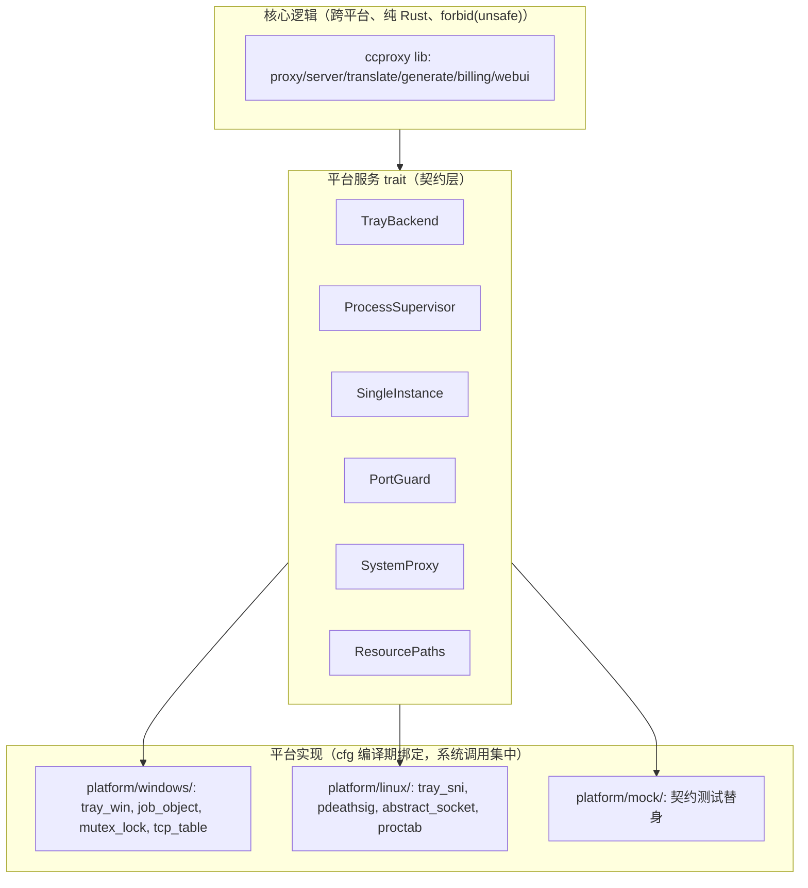

# cc-proxy Linux 移植开发计划

状态：**方案已定，待实施**（2026-10-15 综合评审）
范围：cc-proxy（Rust API 翻译/转发代理）Linux 版——CLI + systemd + SNI 托盘，deb/AppImage/AUR 发布。

---

## 1. 背景与现状

cc-proxy 当前形态：

- `ccproxy`（服务本体，跨平台依赖）+ `CCProxyTray`（Windows 托盘管理器，windows-sys 全 Win32）
- WebUI **已外置**（前端分离，无内联：`/webui/` 静态 serve + ETag 304，commit `4549183`）
- CI 已有：`ci.yml`（ubuntu 质量门 + windows 双构建）、`release.yml`（Windows zip 发布）
- 仓库：`origin` = CelestNya/commandcode-api-proxy（`rust-rewrite` 分支未推）；`gh` 已登录（repo+workflow）
- 项目技能库 6 个（webui-design / proxy-dev-patterns / api-traffic-analysis / rust-performance / ci-pipeline / cross-platform-architecture）

目标：Debian 系 + Arch 系可用，服务 CLI + systemd 自启 + SNI 托盘（KDE/XFCE 原生、GNOME 降级），发布 deb / AppImage / AUR。

## 2. 已定决策（2026-10-15）

| ID | 决策 | 内容 |
|---|---|---|
| D1 | 前端外置 | 已完成（`4549183`）：删 build.rs 内联、`/webui/` 静态 serve、无内联兜底 |
| D2 | 服务 CLI | `ccproxy start\|stop\|status\|logs\|config` 子命令——无桌面时的管理入口（替代 tray 监督角色） |
| D3 | tray 跨平台 | **方案 B**：自研 `TrayBackend` trait + Linux 走 **zbus StatusNotifierItem**（零 GTK 依赖） |
| D4 | 远程 CI | 推 `rust-rewrite` 到 origin，GH Actions 双平台构建（ubuntu = Linux 实证通道） |
| D5 | 发布物 | deb（cargo-deb + systemd unit）+ AppImage（linuxdeploy）+ AUR PKGBUILD |
| D6 | AUR | 暂无 Arch 账号：先本地出 PKGBUILD + .SRCINFO（+ 可选 ccproxy-bin），注册后 `git push` 即发布 |
| D7 | 目录注入 | 打包按系统类型把目录写进**环境变量**（`CC_WEBUI_DIR` / `CC_DATA_DIR` / `CC_LOG_DIR` / `CC_TRAY_LOG_DIR`，沿用现有 CC_ 前缀），代码只读 env + exe 旁兜底，**不做平台检测** |
| D8 | deb systemd | **带 unit**：自启 / 崩溃重启（Restart=on-failure）/ 日志进 journalctl / `User=ccproxy` 低权；非 systemd 用 CLI |
| D9 | 数据路径 | 安装模式：`/var/lib/ccproxy`（配合 User=ccproxy）；便携模式保持 exe 旁 |
| D10 | 托盘验收 | 四层验收：L0 协议（无头 CI）/ L1 呈现（真实桌面）/ L2 行为 / L3 兼容矩阵（见 §6） |

## 3. 架构：三层解耦

- trait 只暴露核心需要的操作（3-5 个方法），不做平台能力全集
- 固定差异用 `#[cfg]`（system_proxy 已是）；需多实现才用 trait + `cfg use ... as`（零动态分发）
- 契约测试：同一组断言对 mock / win 实现 / linux 实现各跑一遍

## 4. 平台能力映射

| 能力 | Windows（现有） | Linux（待实现） |
|---|---|---|
| 托盘 | `Shell_NotifyIconW`（tray.rs/win.rs） | zbus StatusNotifierItem（KDE/XFCE 原生；GNOME 需扩展=降级） |
| 进程回收 | Job Object `KillOnClose` | `prctl(PR_SET_PDEATHSIG)` + 退出时杀进程组 |
| 单实例+交接 | 命名互斥体（owner.rs） | abstract unix socket bind（内核原子）或 flock |
| 端口守卫 | `GetExtendedTcpTable` | `/proc/net/tcp` 或 bind 探测 |
| 系统代理 | 环境变量 + HKCU 注册表（winreg，cfg(windows)） | 环境变量（`system_proxy()` 已优先） |
| 资源路径 | exe 旁 `webui/` | env 注入（D7）→ exe 旁兜底 → 明确 404 |
| 数据/日志 | exe 旁（便携） | 安装模式 `/var/lib/ccproxy`（systemd）；便携保持 exe 旁 |
| 服务管理 | tray 监督 + 自启 | systemd unit（非 systemd 用 CLI） |

## 5. 里程碑与任务分解

### M0 — CI 实证闭环（获得 Linux 编译验证通道）

| 任务 | 内容 | 验收 |
|---|---|---|
| T0.1 | 推 `rust-rewrite` 到 origin | Actions 首次触发 |
| T0.2 | ci.yml 加 `Swatinem/rust-cache`（ubuntu + windows job） | 二次运行命中缓存 |
| T0.3 | release.yml 注释修正（前端分离后"内联副本"表述过时） | 文档与代码一致 |
| T0.4 | Actions 全绿：ubuntu build ccproxy + windows 双构建测试 | 两 job 绿 |

### M1 — 跨平台基础（ResourcePaths + CLI + systemd 设计）

| 任务 | 内容 | 验收 |
|---|---|---|
| T1.1 | `ResourcePaths`：`webui_site_dir()` / `billing_dir()` / `log_path()` / `tray_log_path()` 统一走 env（D7）→ exe 旁兜底 | 单测覆盖 env/缺省/便携三态 |
| T1.2 | CLI 子命令 `start/stop/status/logs/config`（保留 `--import-legacy-usage`）；status=端口/进程/健康；stop=优雅停止 | 隔离实例（PORT=18787）冒烟通过 |
| T1.3 | systemd unit 草案 + 安装布局（`/var/lib/ccproxy`、`EnvironmentFile=/etc/ccproxy/env`、`User=ccproxy`） | docs 落地，M3 打包直接引用 |
| T1.4 | 全量测试回归（220+）+ clippy/fmt | cargo test 全绿 |

### M2 — tray 平台抽象（三层落地）✅ commit `1b26b1d` / `4353735`

| 任务 | 内容 | 状态 |
|---|---|---|
| T2.1 | `TrayBackend` trait 定义 + 契约测试骨架（mock 实现） | ✅ `tray_api.rs`：菜单模型 / TrayEvent / build_menu / MockTray + 10 契约测试 |
| T2.2 | Windows 实现适配 trait | ⚠️ **契约对齐，运行时切换留 v0.8**——Windows 主路径（handover/supervision/job）保持现有 run_ui 驱动零回归；trait 形状已与 Action/menu_entries 一一对应，v0.8 与 AUR 同版切换 |
| T2.3 | Linux zbus SNI 实现 | ✅ `linux/tray.rs`（ksni 0.3 blocking）：IconPixmap 程序化圆点 / dbusmenu 菜单（activate 经 mpsc 投递）/ 状态刷新 / 无 session bus 返回 Unavailable（main 降级退出） |
| T2.4 | 平台化其余 | ✅ `linux/single_instance.rs`（pid 锁 + /proc 存活检查，防 KDE 双图标）；⚠️ PDEATHSIG/abstract socket/PortGuard **不做**——Linux 代理是独立服务（CLI/systemd），tray 经 CLI 启停 + 新进程组，无子进程句柄即无孤儿问题（比 Windows Job Object 更标准） |
| T2.5 | 契约测试三实现全跑 | ✅ mock（本机 50 tests）+ linux 单元测试（CI ubuntu）+ windows 现有测试套件（CI windows）；L0 无头 DBus 断言归 M4 T4.1 |

### M3 — 打包与发布 ✅ commit `b9c12a6` 后续（T3.1–T3.4 配置/脚本已落地，CI 验证中）

| 任务 | 内容 | 验收 | 状态 |
|---|---|---|---|
| T3.1 | deb：cargo-deb（`[package.metadata.deb]` 两 crate；发布名 **commandcode-proxy**；systemd unit → `/lib/systemd/system/`；webui → `/usr/share/commandcode-proxy/webui`；env → `/etc/commandcode-proxy/`；`User=commandcode-proxy` 低权 preinst 创建；postinst 建目录+首装拷 env；`depends=$auto`（rusqlite bundled 零系统依赖）） | `dpkg -i` 后 `systemctl status commandcode-proxy` 正常 + webui 可达 | 配置已写，CI 打包验证中 |
| T3.2 | AppImage：`packaging/appimage/build-appimage.sh`（AppDir：usr/bin/{commandcode-proxy,commandcode-proxy-tray} + webui + AppRun 注入 `CC_WEBUI_DIR=$APPDIR/...` + desktop/icon；appimagetool `APPIMAGE_EXTRACT_AND_RUN=1` 免 FUSE；zbus SNI 无需 GTK） | `--appimage-extract-and-run` 可运行 | 脚本已写，CI 验证中 |
| T3.3 | AUR：**只出 `commandcode-proxy-bin` 预编译**（`packaging/aur/PKGBUILD.template` 占位符渲染 + `verify-aur.sh` 在 archlinux 容器跑真 `makepkg -f` + `makepkg --printsrcinfo` 出 `.SRCINFO`；无 Arch 账号，先本地容器验证，注册后推 aur.archlinux.org） | 容器 makepkg 通过 + 包内含二进制 | 脚本已写，CI 验证中 |
| T3.4 | release.yml 重构三 job：`windows`（zip 改名 **commandcode-proxy-v<ver>-windows-x86_64.zip**）/ `linux`（build+deb×2+AppImage+tarball+PKGBUILD 渲染+AUR 容器验证）/ `publish`（tag-only：softprops 汇总上传全部产物） | 打 tag 自动出 Windows zip + deb×2 + AppImage + tarball + PKGBUILD + .SRCINFO | 已写，workflow_dispatch 验证中 |

### M4 — 托盘验收（集成）

| 任务 | 内容 | 验收 |
|---|---|---|
| T4.1 | L0 无头协议测试接入 CI（dbus-launch + busctl 断言） | L0 6 项断言全过 |
| T4.2 | L1 真实桌面清单：KDE Plasma（X11+Wayland）、XFCE、（GNOME 扩展=降级验证） | 截图/人工清单签字 |
| T4.3 | L2 行为断言：菜单语义 / 单实例交接 / 防孤儿 / 无头降级 | 逐项可复现 |
| T4.4 | L3 兼容矩阵回归 + 验收报告 | 全矩阵通过 + 文档化边界 |

**依赖链**：T0.4 → T1.x → T2.x → T3.x；T4 依赖 T2/T3；T3.1 依赖 T1.1/T1.3。

## 6. 托盘验收标准（四层）

### L0 协议层（无头、CI 自动化——SNI 是 DBus 对象，无需显示服务器）

| # | 断言 | 手段 |
|---|---|---|
| 1 | session bus 注册 `org.freedesktop.StatusNotifierItem-<pid>-<id>` | `busctl --user list` |
| 2 | Watcher 枚举到：`RegisteredStatusNotifierItems` 包含该名字 | `busctl` get-property |
| 3 | 必需属性合法：Category/Id/Title 非空、IconName 或 IconPixmap 非空、Status | `busctl` introspect |
| 4 | `Menu` → dbusmenu 对象，`GetLayout` 返回预期条目（数 + label + 状态） | dbusmenu GetLayout |
| 5 | 状态切换 → `PropertyChanged` 信号 | `dbus-monitor --session` |
| 6 | 退出 → 反注册、watcher 列表移除 | 退出后重查 |

工具：`system-tray` crate 的 Stray（watcher 模拟）或 busctl 命令行。

### L1 呈现层（真实桌面）

| 桌面 | 状态 | 验收 |
|---|---|---|
| KDE Plasma（X11+Wayland） | 原生 SNI | 图标出现 → 右键菜单条目正确 → 启停状态图标/提示变化 |
| XFCE | 原生 SNI | 同上 |
| GNOME（Wayland） | **无原生支持，需 AppIndicator 扩展** | 有扩展显示；无扩展不显示=**预期降级**（文档化，不算缺陷） |

### L2 行为层

菜单"退出"→ 退出码 0 + 子进程回收 + 端口释放；"启动/停止"→ 子进程真实起停；单实例交接 → 服务不中断；强杀 tray → 子进程回收（PDEATHSIG）；无 session bus → 降级 CLI 不崩溃；契约测试三实现全过。

### L3 兼容矩阵

`KDE X11 → KDE Wayland → XFCE → GNOME(Wayland, 有扩展)`，每环境跑：注册 → 显示 → 菜单 → 退出。

## 7. 风险与缓解

| 风险 | 影响 | 缓解 |
|---|---|---|
| GNOME AppIndicator 扩展随大版本失效（GNOME 46/48 有真实案例） | 图标不显示 | 定位为降级场景，README 写明；验收不判 bug |
| SNI 注册竞态（KDE bug 416652：注册后立即销毁留空条目） | 幽灵图标 | 注册/销毁时序处理 + 验收断言"启动即退出不留残留" |
| Wayland 下菜单定位由桌面 shell 决定 | 菜单位置异常 | 不自实现弹出，用 dbusmenu 协议 |
| 本机 Windows 无法交叉编译 Linux（缺 C 编译器） | 本地无法实证 | **M0 CI 先行**；ubuntu runner 自带 gcc/make |
| rusqlite bundled 需 gcc/make | 构建失败 | CI runner 自带；文档注明构建依赖 |
| 若未来出 snap 包 | AppArmor 拦 SNI 对象路径（Electron 真实案例） | 不在本计划范围；届时重验 |

## 8. 发布计划（建议分两版）

| 版本 | 内容 | 说明 |
|---|---|---|
| **v0.7.0**（Linux 里程碑 1） | M0+M1：CLI 版（无 tray），deb + AppImage | 无头服务器/容器可用；tray 未完成前不阻塞 |
| **v0.8.0**（完整 Linux） | M2+M3+M4：tray + 全平台 + AUR | 桌面体验完整，验收报告随版发布 |

Windows 发布流程保持现状（release.yml），Linux 发布并入同一工作流（矩阵 job）。

## 9. 开放问题（已拍板，2026-10-15）

1. **发布节奏** ✅：分两版——v0.7.0（CLI 先行：deb + AppImage）/ v0.8.0（tray 完整 + AUR）；semver：bug→patch、feat→minor、架构→major。
2. **L1 呈现验收 KDE 环境** ✅：用户自备 KDE（有）；**自主截图验证脚本**（最大化解放人工）；**XFCE 不单独验收**（同协议，L0 已覆盖）；**GNOME 不验收**（文档化降级——AppIndicator 扩展随 GNOME 46/48 大版本失效：Red Hat bugzilla 2268403、openSUSE 论坛）。
3. **AUR 包** ✅：只出 **`commandcode-proxy-bin` 预编译**（不碰内核无需重编译；无 Arch 账号先本地 makepkg 验证，注册后推送）。
4. **对外发布名** ✅：`commandcode-proxy`（描述型利于搜索；内部 crate 名 ccproxy 保留，打包层重命名）。
5. **分支模型** ✅：main = 发布主线（release 走主分支），dev = 开发分支；标准发布流程。
