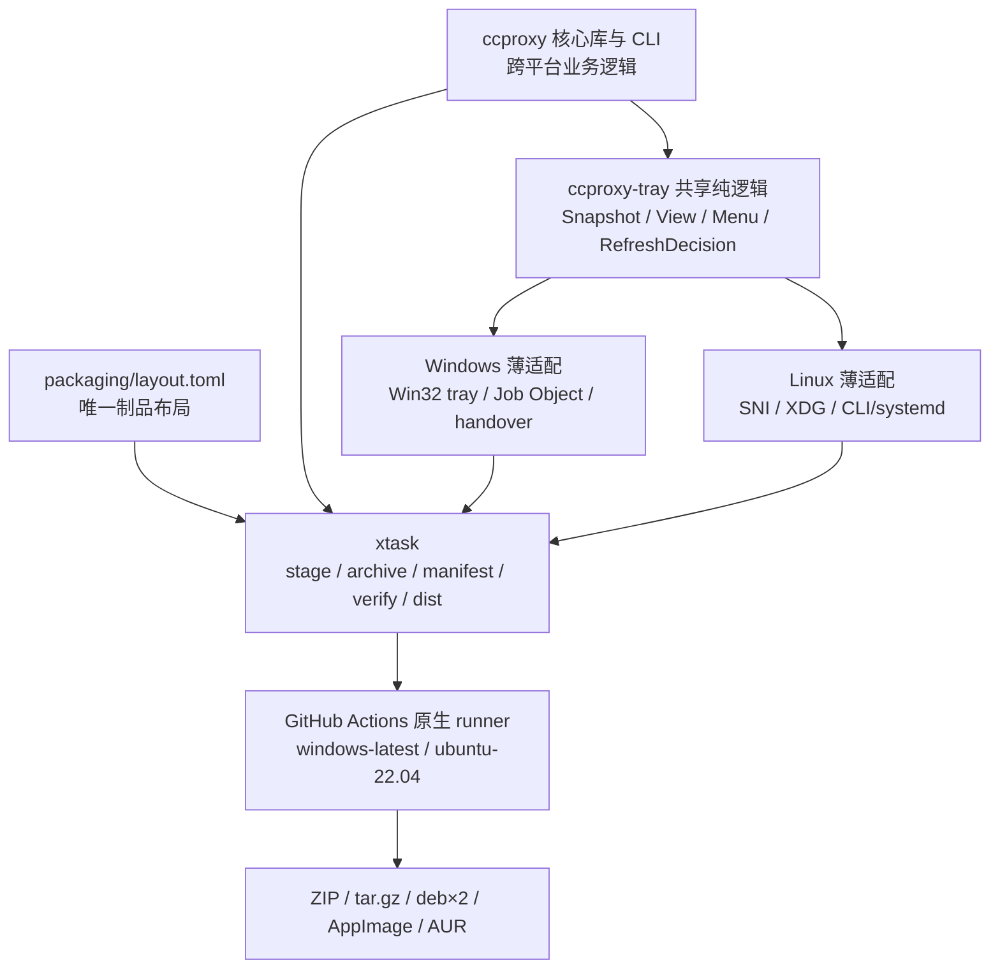

# cc-proxy 多端构建收敛实施规格

> 状态：已拍板，可交给执行模型实施  
> 日期：2026-11-17  
> 最低代码基线：`origin/main` `d2f7cd3`（Linux 托盘真实统计与菜单 ID 修复）  
> 推荐分支：`feat/multidist`  
> 实施范围：Windows x86_64 + Linux x86_64  
> 本文是执行契约，不是讨论稿。除非某条被实测证伪，否则不要自行换架构；证伪时先记录证据，再提出最小修订。

---

## 0. 给执行模型的指令

1. 先完整阅读本文，再读 `docs/DEVELOPMENT.md`、`docs/skills/cross-platform-architecture/SKILL.md`、`docs/skills/ci-pipeline/SKILL.md`。
2. 开工时重新 `git fetch origin`，确认 main 已前进时以最新 main 为基线，并记录实际基线 commit。不要基于旧 `feat/ux` 的托盘源码覆盖 main 的 `d2f7cd3` 修复。
3. 按本文里程碑顺序实施，每个逻辑改动独立 commit；不要混入 WebUI、代理协议、计费或 UI 视觉改动。
4. 不 rewrite 历史，不 `--amend`，不 force push，不跳过 hooks，不擅自合并 main、打 tag、创建 Release 或推 AUR。
5. 不碰工作区已有未跟踪 `.probe/`，不删除用户文件，不操作生产 8787 实例。Windows 验证只用隔离端口与独立数据目录；临时文件写入 `%TEMP%`（本机为 `D:\Windows\UserTemp`），禁止写 `D:\Temp`。
6. 每个里程碑先补会失败的契约测试，再实现；完成后运行该里程碑质量门。最终必须实际构建并检查产物，不能仅凭编译通过宣称完成。
7. 若工具行为不确定（例如 `dpkg-deb`、`appimagetool` 参数），先查当前安装版本帮助并做最小实证，不凭记忆堆参数。
8. 最终报告必须列出：实际基线、每个 commit hash、修改文件、执行过的命令及结果、CI 运行链接、产物逐项核验结果、仍未覆盖的实机验收。文档中不写动态测试数量。

---

## 1. 背景与问题定义

当前核心代理已经基本跨平台，复杂维护主要来自：

- Windows 与 Linux 托盘的菜单、刷新、状态语义仍有重复实现；最新 main 已将 `cache_lines`、`fmt_tokens`、`menu_id_map` 收回 `tray_api.rs`，说明共享纯逻辑的方向有效。
- Windows ZIP 由 PowerShell 组装，Linux tarball/AppImage 由 Bash 组装，deb 又在 `Cargo.toml` 列资产；同一文件布局有多份描述。
- WebUI 文件在 `Cargo.toml` 逐文件列出，新增静态资源可能需要同步修改打包配置，和“`index.html` 是唯一前端引用清单”的原则冲突。
- CI 与 Release 分别调用构建和打包步骤，本地 `build-rust.cmd` 又维护一份 Windows staging。
- `ccproxy-tray` 使用 `cfg(unix)` 选择 Linux SNI、`/proc` 与 XDG 行为。该写法会把其他 Unix 错当成 Linux，不利于未来扩展。

因此，本项目要统一的是：**业务语义、制品布局、打包入口和验证契约**；不是强行统一操作系统 API，也不是追求“一台机器交叉构建所有平台”。

---

## 2. 目标、非目标与硬约束

### 2.1 本期目标

1. Windows/Linux 都在各自原生 GitHub runner 构建与测试。
2. 新增一个 Rust `xtask`，成为本地与 CI 共用的唯一 staging、归档、清单与验证入口。
3. 用一份声明式布局描述派生 Windows ZIP、Linux tarball、两个 deb、AppImage 与 AUR 输入。
4. 保持 Windows 便携目录、Release 资产名、ZIP entry 分隔符与自更新读取契约不变。
5. 保持 Linux systemd、deb 拆分、AppImage、AUR 的现有对外行为，不因重构改变服务管理语义。
6. 托盘只共享平台无关的视图与刷新决策；Windows 进程监督、两阶段交接和 Linux SNI 事件循环不做高风险重写。
7. 将托盘侧的 `cfg(unix)` 精确化为 `cfg(target_os = "linux")`，避免未来 macOS 错走 Linux 实现。
8. 构建、打包、验证命令在本地与 CI 完全一致。

### 2.2 非目标

- 本期不发布 macOS，不实现 macOS 托盘、签名、公证、launchd 或 dmg。
- 不引入 Tauri、Electron、WebView、Node 或新的 GUI 框架。
- 不使用 `cross`/cargo-zigbuild 取代 Windows/Linux 原生 runner。
- 本期不接入 cargo-dist，避免形成第二套发布入口；统一 `xtask` 后可另开 ADR 评估其通用 Release 能力。
- 不统一 Windows 与 Linux 的进程生命周期模型：Windows 保留 Job Object + tray supervision + handover；Linux 保留 CLI/systemd + SNI。
- 不改变代理核心 `#![forbid(unsafe_code)]`，不引入 async runtime。
- 不改变版本号、CHANGELOG 发布日期或发布节奏；实施分支本身不是 Release。

### 2.3 不可破坏的不变量

#### Windows

- ZIP 根目录：
  - `CCProxyTray.exe`
  - `package.json`
  - `service/ccproxy.exe`
  - `service/ccproxy.json`
  - `service/webui/**`
- ZIP entry 一律使用 `/`，不包含额外顶层目录，不包含绝对路径、`..`、日志、数据库或 `selfcheck.log`。
- `package.json` 与 `service/ccproxy.json` 为无 BOM UTF-8；默认配置不得复制开发者本机配置。
- 资产名保持 `commandcode-proxy-v<version>-windows-x86_64.zip`，因为 `update.rs::asset_suffix()` 依赖它。
- `ccproxy::archive` 能读取新 ZIP；`service/` 布局仍能让更新器定位 tray、配置与安装根。
- `build-rust.cmd` 不带 `--promote` 时仍不得切换生产；`--promote` 语义、运行目录占用保护和 `-previous` 回滚目录保留。

#### Linux

- 通用 tarball 资产名为 `commandcode-proxy-<version>-linux-x86_64.tar.gz`（**没有 `v` 前缀**——此处在 §2.3 初稿误写为 `v<version>`，经核对 GitHub Releases v0.7.9/v0.7.10/v0.7.11 实际资产后修正；AUR PKGBUILD 与用户脚本按此名字拉取，不能再加 `v`）。
- 两个 deb 仍分为 `commandcode-proxy_<version>-1_amd64.deb` 与 `commandcode-proxy-tray_<version>-1_amd64.deb`（Debian 命名 `pkg_ver-rev_arch.deb`，不带 `v`），tray 的 `Depends` 为 `commandcode-proxy (= <version>-1)`。
- systemd unit 的 `User/Group`、目录、环境变量、重启与沙箱策略不变；maintainer scripts 的 install/remove/purge 语义不变。
- AppImage 继续通过 `CC_WEBUI_DIR` 指向 AppDir 内 WebUI；无需 GTK/Qt。
- AUR 继续只提供 `commandcode-proxy-bin` 预编译包，并由真实 `makepkg` 验证。
- Linux Release 继续在 `ubuntu-22.04` 构建，维持当前 glibc 基线，不改用 `ubuntu-latest`。

---

## 3. 目标架构



### 3.1 目录目标

```text
.github/workflows/
  ci.yml
  release.yml
.cargo/
  config.toml                 # cargo xtask alias
crates/
  ccproxy/                    # 核心，保持现有结构
  ccproxy-tray/
    src/
      main.rs                 # 平台入口与现有生命周期逻辑
      tray_api.rs             # 菜单、事件、统计格式、ID 映射
      tray_view.rs            # 新增：Snapshot -> View，纯函数
      refresh.rs              # 新增：刷新/推送决策，纯函数
      linux/                  # 仅 target_os = "linux"
      ...                     # Windows 现有文件不大规模搬移
xtask/
  Cargo.toml
  src/
    main.rs                   # 仅参数解析与退出码
    lib.rs                    # 命令分发
    layout.rs                 # manifest 解析与校验
    stage.rs                  # 安全 staging
    archive.rs                # ZIP/tar.gz 与确定性规则
    manifest.rs               # 文件哈希、SHA256SUMS
    verify.rs                 # 产物契约验证
    deb.rs                    # Debian root/control 生成
packaging/
  layout.toml                 # 唯一文件布局与 package 分组
  systemd/                    # 保留
  deb/                        # maintainer scripts、env、control 模板
  desktop/                    # 保留
  icons/                      # 保留
  appimage/                   # 只保留 AppRun/工具调用薄壳
  aur/                        # PKGBUILD 模板与容器验证
```

约束：

- Windows 现有 `owner.rs`、`process.rs`、`supervision.rs`、`win.rs` 等不做为了“目录好看”的大规模改名。
- `xtask` 是开发工具，不进入运行产物；workspace 增加 `default-members = ["crates/ccproxy", "crates/ccproxy-tray"]`，避免普通构建默认编译工具链。
- `xtask` 自身禁止 `unsafe`，沿用 workspace lint、fmt 与错误处理标准；不得用 `unwrap/expect/panic` 处理用户输入或文件错误。

---

## 4. 唯一布局描述：`packaging/layout.toml`

### 4.1 设计

布局文件描述“源文件/目录 → 目标相对路径 → mode → 产物分组”。版本、target dir、repo root 不重复写死。

建议 schema（执行时可按 serde 习惯微调字段名，但能力不得减少）：

```toml
[[entry]]
source = { built = "CCProxyTray" }
dest = "CCProxyTray.exe"
targets = ["windows-portable"]

[[entry]]
source = { built = "ccproxy" }
dest = "service/ccproxy.exe"
targets = ["windows-portable"]

[[entry]]
source = { generated = "windows-package-json" }
dest = "package.json"
targets = ["windows-portable"]

[[entry]]
source = { generated = "windows-default-config" }
dest = "service/ccproxy.json"
targets = ["windows-portable"]

[[entry]]
source = { tree = "crates/ccproxy/webui" }
dest = "service/webui"
targets = ["windows-portable"]

[[entry]]
source = { built = "ccproxy" }
dest = "usr/bin/commandcode-proxy"
mode = 0o755
targets = ["linux-portable", "deb-proxy", "appimage"]

[[entry]]
source = { built = "CCProxyTray" }
dest = "usr/bin/commandcode-proxy-tray"
mode = 0o755
targets = ["linux-portable", "deb-tray", "appimage"]

[[entry]]
source = { tree = "crates/ccproxy/webui" }
dest = "usr/share/commandcode-proxy/webui"
mode = 0o644
targets = ["linux-portable", "deb-proxy", "appimage"]
```

其余 entry 必须覆盖 systemd unit、desktop、icon、env.example。`deb-proxy` 不包含 tray/desktop，`deb-tray` 不包含 proxy/webui/systemd/env；共享图标与 desktop 归 `deb-tray`。

### 4.2 校验规则

`xtask layout --check` 必须拒绝：

- 空 source/dest、绝对目标路径、`..`、Windows prefix、反斜杠目标路径。
- 同一 target 下重复 dest。
- 未知 target、未知 built binary、未知 generated kind。
- 源文件不存在；WebUI tree 为空。
- symlink 源文件/目录。第一版明确不支持 symlink，不能悄悄跟随到 workspace 外。
- Windows 目标混入 Linux 路径，或 Linux 目标混入 `.exe`。
- 同一目标产物中存在 mode 冲突。

### 4.3 WebUI 完整性

- WebUI 使用整目录递归复制，不再逐文件列在 `Cargo.toml`。
- staging 后解析 `webui/index.html` 的本地 CSS/JS 引用，确认所有引用文件存在；复用或抽取 `webui_site.rs` 的引用解析逻辑，避免维护第二套宽松解析器。
- 不复制 `.map`、日志、截图、测试输出、隐藏 VCS 文件；如确需排除规则，必须在 layout 中显式声明并有测试。

完成后的可衡量结果：**新增一个被 `index.html` 引用的 WebUI 静态文件，不需要修改任何打包配置。**

---

## 5. `xtask` 命令契约

在 `.cargo/config.toml` 增加别名，使用户命令统一为 `cargo xtask ...`。所有路径参数都必须是显式路径；默认输出仅允许 workspace 下 `dist/`。

### 5.1 子命令

```text
cargo xtask layout --check

cargo xtask stage \
  --platform windows|linux \
  --target windows-portable|linux-portable|deb-proxy|deb-tray|appimage \
  --out dist/stage/<target>

cargo xtask archive \
  --platform windows|linux \
  --input dist/stage/<target> \
  --out dist/<canonical-artifact-name>

cargo xtask manifest \
  --input dist/stage/<target> \
  --artifact dist/<artifact> \
  --out dist/<artifact>.manifest.json

cargo xtask verify \
  --platform windows|linux \
  --target <target> \
  --input dist/stage/<target> \
  [--artifact dist/<artifact>]

cargo xtask dist --platform windows --skip-build
cargo xtask dist --platform linux --skip-build
```

`dist` 默认依次执行：layout check → 必要时 build → clean 自己的 dist 子目录 → stage → archive → manifest → verify。`--skip-build` 只跳过 Cargo 编译，不跳过测试和验证。

### 5.2 路径与安全

- 每次清理输出目录前，同时 canonicalize workspace root、dist root 与目标父目录；目标必须位于预期 dist 子树，拒绝直接传 `D:\`、`/`、repo root 或任意已存在非工具目录。
- 不调用 `cmd /c`、shell 字符串拼接或 `rm -rf` 完成复制/删除；使用 Rust fs API。
- 所有外部命令以 argv 数组调用，不经过 shell；路径与版本号不得形成命令注入。
- 失败即非零退出，不留下“成功”manifest；已产生的半成品明确标为无效。

### 5.3 版本与 target dir

- 版本唯一来源为 workspace `Cargo.toml`，校验 semver 形状；不得从本机 `package.json` 推断。
- 尊重 `CARGO_TARGET_DIR`，缺省为 `<workspace>/target`。
- release binary 只从 `<target-dir>/release/` 读取；不存在时给出明确错误，不静默用 debug binary。

### 5.4 归档确定性

- 文件按规范化相对路径排序。
- ZIP entry 使用 `/`，UTF-8 名称，无额外根目录；采用现有 updater 支持的 Store 或 Deflate 方法，优先 Deflate。
- ZIP 时间戳固定为合法最小时间；tar.gz 的 mtime/uid/gid 固定，文件 mode 来自 layout。
- 对同一输入连续打包两次，SHA-256 必须一致。
- 生成 `SHA256SUMS` 与 JSON manifest，包含版本、平台、架构、相对路径、大小和 SHA-256。
- 归档验证不能只检查“文件非空”：必须枚举 entry、逐文件比对 manifest，并确认无额外文件。

---

## 6. 各产物迁移方案

### 6.1 Windows ZIP

1. `release.yml` 删除 PowerShell staging 与 `zip-package.ps1` 调用，改为 `cargo xtask dist --platform windows --skip-build`。
2. `build-rust.cmd` 只保留：构建、测试、桌面候选发布、`--promote`、占用保护和回滚目录逻辑；staging 改为调用同一个 `cargo xtask stage`。
3. 新 ZIP 必须由 `ccproxy::archive::read` 实际读取，至少验证：
   - `service/ccproxy.exe`、`CCProxyTray.exe`、`package.json` 存在；
   - `service/webui/index.html` 存在；
   - 所有 entry 使用安全相对路径；
   - entry 内容哈希与 staging 一致。
4. `packaging/windows/zip-package.ps1` 在新路径通过 CI 与隔离更新测试后删除，不保留双实现。

### 6.2 Linux tarball

1. `xtask` 从 `linux-portable` staging 生成 tar.gz。
2. AUR 的 `build-tarball.sh` 改为薄包装或删除，Release 不得再自行复制一套文件。
3. 解包后核对 `usr/bin`、WebUI、unit、desktop、icon、env.example 与 manifest。
4. tar entry 使用相对路径，拒绝绝对路径与 `..`；AUR `package()` 能直接消费。

### 6.3 两个 deb

优先方案：**由 `xtask` 生成标准 Debian root，再用系统 `dpkg-deb` 构建**，从而移除 `cargo-deb` 安装与 `Cargo.toml` 的重复资产清单。

1. `deb-proxy` root 包含 proxy、WebUI、systemd、env.example 与 `DEBIAN/`。
2. `deb-tray` root 包含 tray、desktop、icon 与 `DEBIAN/`。
3. maintainer scripts 原样复用 `packaging/deb/scripts/`，`sh -n` 验证。
4. control 字段来自 workspace/package metadata：Package、Version、Architecture、Maintainer、Section、Priority、Description。
5. 共享库依赖不得靠猜：在 Ubuntu runner 用 `dpkg-shlibdeps` 对实际 binary 生成依赖；tray 额外声明对同版本 `commandcode-proxy` 的依赖。若实证表明现有项目接入 `dpkg-shlibdeps` 不合理，可保留 cargo-deb 作为**唯一例外**，但必须删除 Cargo.toml 逐文件 WebUI 清单并证明目录资产由 layout staging 提供，不得手工再抄一份。
6. 使用 `dpkg-deb --build` 后，以 `dpkg-deb --info/--contents` 和临时目录解包验证；包名、版本、架构、依赖、mode、maintainer scripts 全部检查。
7. 只有新 deb 路径在 Ubuntu 22.04 容器安装并运行隔离 proxy 后，才删除 `cargo install cargo-deb` 和旧 metadata。

### 6.4 AppImage

1. `xtask` 生成 AppDir，二进制、WebUI、desktop、icon 来自 `appimage` target。
2. AppRun 与 appimagetool 下载/调用可保留薄 shell 脚本，但脚本不得再复制二进制和 WebUI。
3. appimagetool 下载需校验固定版本或哈希；不要长期跟踪不可复现的 `continuous` 内容而不记录实际哈希。若暂时保留 continuous，必须把下载文件 SHA-256 写入构建日志和 manifest，并将固定版本列为明确后续缺口。
4. CI 用 `APPIMAGE_EXTRACT_AND_RUN=1` 构建；解包后比较 AppDir 与 manifest，运行 `--appimage-extract-and-run` 的受支持只读命令验证入口。

### 6.5 AUR

1. 继续消费唯一 Linux tar.gz，SHA-256 由 `xtask manifest` 提供。
2. `PKGBUILD.template` 只保留包元数据和安装逻辑；渲染脚本不再负责 staging。
3. `verify-aur.sh` 继续在 Arch 容器跑真实 `makepkg -f` 和 `makepkg --printsrcinfo`。
4. 最终 Release 上传 PKGBUILD、.SRCINFO；容器中间产物不作为正式资产。

---

## 7. 托盘共享逻辑收敛（低风险版）

### 7.1 精确平台条件

- `ccproxy-tray/src/main.rs`、模块声明及依赖中，Linux 专用 `cfg(unix)` 改为 `cfg(target_os = "linux")`。
- `Cargo.toml` 的 `ksni` 与 Linux 测试 `zbus` 同样改为 `target_os = "linux"`。
- 非 Windows 且非 Linux 的 tray target 给出明确 `compile_error!`，提示使用 `ccproxy` CLI；不能悄悄编译出一个空 `main`。
- `ccproxy` 核心里的 Unix signal、`cfg(not(windows))` 系统代理环境变量逻辑不全局替换；逐处判断语义，禁止机械搜索替换。

### 7.2 `TraySnapshot` 与 `TrayView`

新增纯数据结构，字段可按现有需求落地：

```text
TraySnapshot {
  running: bool,
  autostart: bool,
  image_compress: bool,
  cache: (String, String),
  staged_version: Option<String>,
  version: String,
  port: u16,
}

TrayView {
  status: TrayStatus,
  menu: Vec<MenuItem>,
  tooltip: String,
}
```

`TrayView::from_snapshot(snapshot)` 是唯一视图构建入口：

- 菜单统一调用 `tray_api::build_menu`。
- tooltip 的 running/stopped、port、version 格式统一。
- Windows 的 staged update 菜单语义保留；Linux 没有 staged update 时不伪造该动作。
- `Quit` 的真实效果不塞进 View：Windows 退出同时停子代理，Linux 退出 tray 不擅自停 systemd/独立服务，由平台动作层保持差异。

### 7.3 刷新决策共享

将 main 最新 Linux 修复中的规则抽成纯函数：

- 人工动作立即请求刷新。
- running/autostart/image_compress 变化立即推送。
- 纯统计计数变化最多每 5 秒推送。
- 后台周期探测保持现状（当前为 1.5 秒），不得在 ksni 服务线程直接 `Handle::update`。
- Windows 可继续在展开菜单时现读，不为“统一”而强加 Linux 轮询线程。

用表驱动测试覆盖：首次、无变化、生命周期变化、统计变化但未到 5 秒、统计变化已到 5 秒、人工唤醒、断连退出。

### 7.4 明确不重写的内容

- Windows `run_ui`、Job Object、port guard、两阶段 handover、崩溃重启策略保持原路径。
- 本期不要求 Windows 改用 `TrayBackend`，也不把 Windows 的 `Rc/RefCell` 强行套进 Linux `Send` 回调模型。
- 共享的是快照、菜单、文案、状态与刷新决策，不是线程模型和系统服务语义。

---

## 8. CI 与 Release 设计

### 8.1 CI

`.github/workflows/ci.yml` 保留三类高信号检查：

1. **quality（Ubuntu）**：fmt、workspace clippy `-D warnings`、workspace test、rustdoc `-D warnings`，包含 `xtask` 自身测试。
2. **native-test matrix**：`windows-latest` 与 `ubuntu-22.04` 原生 build/test；Linux 使用 22.04 与 Release 对齐。
3. **linux-sni-smoke**：保留私有 DBus/SNI 契约测试，不因构建重构删除。

`xtask` 新依赖变化后必须更新并提交 `Cargo.lock`，所有命令使用 `--locked`。

### 8.2 Release

- `windows` job：windows-latest → test → build → `cargo xtask dist --platform windows --skip-build` → upload。
- `linux` job：ubuntu-22.04 → test → build → `cargo xtask dist --platform linux --skip-build` → deb/AppImage/AUR 薄步骤 → upload。
- `publish` job 仍只在 tag 触发；`workflow_dispatch` 只构建和上传 Actions artifacts，不创建/修改 GitHub Release。
- 发布文件通配符必须精确，不把 staging、AppDir、debian root、容器 `pkg/` 或 debug 包上传。
- GitHub Release 仍由现有 `softprops/action-gh-release` 统一创建；不引入第二个发布动作。

### 8.3 缓存与权限

- 保持 `Swatinem/rust-cache`，按 OS/target 隔离缓存，不让 Windows 与 Linux 共用 target 产物。
- 构建 job `permissions: contents: read`，仅 publish 为 `contents: write`。
- 不在日志输出 API key、真实本机配置或凭据。

---

## 9. 测试与验收矩阵

### 9.1 每个 commit 的最低质量门

```bash
cargo fmt --check
cargo test --workspace --locked
cargo clippy --workspace --all-targets --all-features --locked -- -D warnings
cargo doc --workspace --no-deps --locked
# RUSTDOCFLAGS=-D warnings
```

平台特定测试必须在对应原生 runner 再跑；Windows 本地全绿不能替代 Ubuntu clippy/test，反之亦然。

### 9.2 `xtask` 单元与集成测试

- layout 接受两个平台的合法最小配置。
- 重复 dest、绝对路径、`..`、反斜杠、未知 target、缺失源、symlink 全部失败。
- Windows 默认配置和 package.json 无 BOM，版本准确。
- WebUI 新文件自动进入 staging；index 引用缺失时验证失败。
- staging 不含 logs、billing db、selfcheck、本机配置。
- 同输入两次 ZIP/tar.gz 的哈希一致。
- ZIP 能被 `ccproxy::archive` 读取，且路径安全测试不回归。
- manifest 能发现内容被改动、额外文件和缺失文件。
- dist 清理路径越界必须在执行删除前失败。

### 9.3 Windows 产物验收

在隔离目录解压真实 ZIP：

1. 设置独立 `CC_TRAY_NS`、`CC_TRAY_PORT=18787`、`CC_DATA_DIR`、`CC_LOG_DIR`、`CC_TRAY_LOG_DIR`，目录位于 `%TEMP%`。
2. 启动解压后的 proxy，验证 `/health`、`/webui/` 与至少一个 CSS/JS 静态资源。
3. 执行 tray `--selfcheck`，确认识别同包 proxy 与正确隔离端口，不接管生产。
4. 若托盘动作层有改动，再跑隔离 handover/chaos；仅打包重构时不把未改代码的全量手工验收伪称为已覆盖。
5. 验证进程全部停止、临时实例无残留；生产 8787 只读探测，不重启、不更新。

### 9.4 Linux 产物验收

在 Ubuntu 22.04 runner/container：

1. tar.gz 解包后以独立 `PORT`、`CC_DATA_DIR`、`CC_LOG_DIR`、`CC_WEBUI_DIR` 启动 proxy，验证 health 与 WebUI。
2. deb 解包/安装后检查 binary、unit、WebUI、env、desktop/icon 和 maintainer scripts。
3. 在容器中执行 `sh -n`、systemd unit 静态检查；若容器无 systemd，不得宣称完成真实 systemctl 启停验收，应列为剩余实机项。
4. AppImage 解包与入口 smoke。
5. Arch 容器 `makepkg` 通过。
6. SNI 无头契约保持通过；KDE 视觉与点击验收仍按既有 M4 清单，不因打包通过而关闭。

**本轮验收状态（`desktop-acceptance` workflow，分支 `feat/desktop-acceptance`，HEAD `d34c3b4`）**：上述 1/2/3/4 项已由 hosted runner 上的真实运行验收覆盖，不再是静态检查；KDE 视觉与点击（第 6 项的桌面部分）本轮仍未绿。逐项对应：

| §9.4 条目 | 对应 job / 脚本 | 本轮状态 |
|---|---|---|
| 1. tar.gz 隔离 health/WebUI | `service-smoke`（`service-smoke.sh`，PORT 18791） | 真绿：隔离 `PORT`/`CC_DATA_DIR`/`CC_LOG_DIR`/`CC_WEBUI_DIR` 真跑，health、WebUI、静态资源、目录契约、优雅退出通过 |
| 2. deb 安装后契约 | `systemd-deb`（`systemd-deb-acceptance.sh`，PORT 18789） | 真绿：真实 `apt-get install` 两个 deb，binary/unit/WebUI/env/服务账号/目录归属随安装流程校验 |
| 3. 真实 systemctl 启停与 journal | `systemd-deb`（同上） | 真绿：`enable/start/stop/restart/disable/purge` 全流程，MainPID/exe 归属、journal 监听行、隔离端口、日志目录校验通过；容器无 systemd 的限制由该 job 跑在完整 VM 上规避 |
| 4. AppImage 入口 smoke | `appimage-fuse`（`appimage-fuse-acceptance.sh`，PORT 18790） | 真绿：真实 FUSE 挂载（不用 `--appimage-extract-and-run`），进程来自挂载点，health/WebUI 200，退出后挂载与端口释放 |
| 5. Arch 容器 `makepkg` | 既有 release dry-run / AUR 脚本 | 保持已过；AUR 真实 `git push` 发布仍未做 |
| 6. SNI 无头契约 | `ci.yml` `linux-sni-smoke` | 保持通过；菜单 DBus 语义仍归该 job，desktop-acceptance 只做像素与点击 |
| 6. KDE 视觉与点击 | `kde-wayland`（PORT 18792）、`kde-x11`（PORT 18793） | **红**：两类根因与未推送修复见 §14 与 REPORT「本轮 Linux 桌面/服务验收」；修复结果以随后一次 run 为准 |

打包入口收敛到 `packaging/ci/build-linux-artifacts.sh`（一次构建产两个 deb + AppImage + tarball + `SHA256SUMS`/`artifacts.txt`）；`release.yml` 本轮未接入该共享脚本。运行说明见 [`DESKTOP-ACCEPTANCE-CI.md`](DESKTOP-ACCEPTANCE-CI.md)。

### 9.5 最终 Release dry-run

- 用 `workflow_dispatch` 跑完整 Release，不发布。
- 下载 Actions artifacts，按本文逐项验证名称、布局、哈希与隔离运行。
- dry-run 全绿后，才由 owner 决定是否走 tag Release。

---

## 10. 分阶段提交计划

### M0 — 基线与契约保护

**commit 1：`test(dist): pin current artifact and updater contracts`**

- 记录实际基线；补上当前 Windows ZIP 布局、资产名、ZIP `/` 分隔符、Linux 包拆分的契约测试。
- 能从当前实现抽出测试就先抽，不能为了测试先写新打包器。
- 产出测试失败/通过证据，确认测试能抓住房改布局、漏 WebUI 和错误 ZIP entry。

### M1 — xtask 与唯一布局

**commit 2：`feat(xtask): add declarative staging and artifact manifests`**

- 新建 xtask、layout.toml、stage/archive/manifest/verify。
- 暂不接 Release；用测试证明新 staging 与现有产物等价。
- 若发现非等价项，逐项判断是 bug 还是无意义元数据差异，不得悄悄改变对外布局。

### M2 — Windows 单入口

**commit 3：`refactor(build): route Windows packaging through xtask`**

- Release 与 `build-rust.cmd` 接入 xtask。
- 验证真实 ZIP、自更新读取与隔离实例。
- 删除旧 zip PowerShell 实现，更新注释与开发文档。

### M3 — Linux 单入口

**commit 4：`refactor(build): derive Linux packages from the shared layout`**

- tarball/deb/AppImage/AUR 全部消费同一 staging。
- 移除逐文件 WebUI 资产清单和重复 staging；cargo-deb 是否保留严格按 §6.3 证据决定。
- 完成 Linux 原生与容器验证。

### M4 — 原生 CI/Release 收敛

**commit 5：`ci: unify native build and dry-run release commands`**

- CI/Release 调用相同 xtask 命令。
- 保留 ubuntu-22.04、Windows runner、SNI smoke 与 tag-only publish。
- workflow_dispatch 验证 artifacts。

### M5 — 托盘共享纯逻辑

**commit 6：`refactor(tray): share view state and refresh decisions`**

- 精确 Linux cfg，增加 Snapshot/View/RefreshDecision。
- 接入 main 最新 Linux 刷新逻辑和 Windows 菜单视图，不改 handover。
- 表驱动测试 + 双平台原生测试 + SNI smoke。

### M6 — 文档与清理

**commit 7：`docs: describe the single multiplatform packaging entrypoint`**

- 更新 `README.md`、`docs/DEVELOPMENT.md`、本规格实施状态。
- 按 Self-Evolving 更新 `docs/skills/ci-pipeline/SKILL.md` 与 `cross-platform-architecture/SKILL.md`。
- 修正旧注释（例如“Windows-only tray”“内联 WebUI 副本”），不写动态测试数量。
- 删除已确认无调用的旧脚本；保留仍有外部入口的薄兼容包装并标明唯一实现位置。

---

## 11. 回滚策略

- 每个里程碑独立可 revert；不要在同一 commit 同时改打包器、托盘生命周期和 Release 发布动作。
- M2/M3 未通过真实产物验证前，不删除旧实现。
- 新 pipeline 出问题时可 revert 对应 commit，旧 tag 与旧 Releases 保持不变。
- 不用改资产名做“临时绕行”，避免老版本 updater 找不到资产。
- 已创建的错误 GitHub Release 不由执行模型自行删除；先报告 owner。

---

## 12. 完成定义（必须全部满足）

- [x] Windows/Linux 均从原生 runner 构建，未引入交叉编译工具链。（windows-latest + ubuntu-22.04）
- [x] 本地与 CI 使用同一个 `cargo xtask` 打包入口。
- [x] 只有 `packaging/layout.toml` 描述制品文件布局，没有第二份逐文件 WebUI 清单。（cargo-deb metadata 已删；PKGBUILD `package()` 只 `cp -a usr lib etc`）
- [x] Windows ZIP 名称、目录、entry `/`、自更新读取全部兼容。（`crates/ccproxy/tests/dist_contract.rs` 钉住；xtask 用 `ccproxy::archive::read` 回读）
- [x] `build-rust.cmd` 的候选/生产分离、占用保护和 `--promote` 语义未变。（只把 staging 改为调用 `cargo xtask stage`，占用保护/`-previous`/`--promote` 逻辑原样保留）
- [x] Linux tarball、deb×2、AppImage、AUR 均从同一 staging 派生并通过各自验证。（xtask 铺 root；runner 跑 `dpkg-shlibdeps`/`dpkg-deb --field/--contents` 断言、appimagetool、Arch 容器 `makepkg`）
- [x] Release dry-run 不发布，正式 publish 仍 tag-only。（`workflow_dispatch` run `44140879436`：windows ✅、linux ✅（含 AppImage 与 AUR makepkg）、publish skipped；artifacts 已下载逐件核验，`publish` 仍 tag-only）
- [x] 托盘共享纯逻辑已收敛，Windows handover 与 Linux SNI 生命周期未被强行统一。（`tray_view.rs`/`refresh.rs`/`tray_api.rs`；Win32 handover、Linux SNI 各走原路径）
- [x] Linux 专用 cfg 不再泛化为全部 Unix；不支持的平台有明确错误。（`cfg(target_os = "linux")` + `compile_error!`）
- [x] 全 workspace fmt/test/clippy/doc 质量门通过，平台测试在对应 OS 通过。（ci.yml `quality` + `native-test` matrix）
- [x] 真实产物已解包核验并完成隔离运行，不只是“打包命令退出 0”。（CI：ZIP 回读 + entry/哈希与 manifest 逐件比对、deb field/contents 断言、AppImage 锚点、makepkg；本机隔离：Windows ZIP 在端口 18788 实跑 `/health`/`/webui/`/静态资源/`--selfcheck` 通过、生产 8787 未触碰；另用 python 独立复检 tar.gz 28 entries、两 deb 各 21 项结构断言。剩余实机项见 §14）
- [x] 文档与项目 skills 已更新，剩余 KDE/systemd 实机验收被如实列出。
- [x] 未打 tag、未发布 Release、未推 AUR、未操作生产实例。

---

## 13. 最终交付报告模板

```text
基线：
分支：
提交（按逻辑列出 hash + 标题）：

架构结果：
- 唯一布局：
- 唯一命令：
- CI 原生目标：
- 保留的平台差异：

验证：
- fmt：
- test：
- clippy：
- doc：
- Windows ZIP 解包 + ccproxy::archive：
- Windows 隔离 health/WebUI/selfcheck：
- Linux tarball 隔离 health/WebUI：
- deb info/contents/install smoke：
- AppImage smoke：
- AUR makepkg：
- SNI contract：
- Release dry-run 链接：

产物（名称 + SHA-256）：

未覆盖/限制：
- KDE 真实桌面：
- systemd 真实启停：
- 其他：

没有执行的操作：
- 未操作生产 8787
- 未打 tag / 未发布 Release / 未推 AUR
```

执行到此处才允许宣称本期完成；任何未覆盖项必须保留为未完成，不得用“应该没问题”替代。

---

## 14. 实施状态（M6 收尾，2026-11-18；最终 dry-run 已全绿）

分支 `feat/multidist`，基线 `origin/main` `d2f7cd3`，HEAD `77423ea`。里程碑与实际 commit（按时间序）：

| 里程碑 | commit | 结果 |
|---|---|---|
| M0 基线与契约保护 | `af1dc6d` test(dist): pin current artifact and updater contracts | 钉住 Windows ZIP 布局/资产名/`/` 分隔符/Linux 包拆分与 updater 契约（`crates/ccproxy/tests/dist_contract.rs`） |
| M1 xtask 与唯一布局 | `84d90eb` feat(xtask): add declarative staging and artifact manifests；`9ae9609` fix(xtask): restrict staging to tool dirs and write per-artifact manifests | 新建 xtask + `packaging/layout.toml` + stage/archive/manifest/verify；staging 收敛到工具目录、逐产物 manifest |
| M2 Windows 单入口 | `ef96c61` refactor(build): route Windows packaging through xtask | Release 与 `build-rust.cmd` 接入 `cargo xtask stage/dist`；旧 `packaging/windows/zip-package.ps1` 删除，不留双实现 |
| M3 Linux 单入口 | `95b9b01` refactor(build): derive Linux packages from the shared layout；`afb4b49` fix(dist): preserve published Linux asset names and align package layout | tarball/deb root/AppDir/AUR 全部从同一 layout staging 派生；保留线上已发布资产名（Linux tarball 无 `v`） |
| M5 托盘共享纯逻辑 | `b852463` refactor(tray): share view state and refresh decisions；`35fa939` chore(tray): drop dead cargo-deb metadata；`f34661e` fix(tray,test): linux clippy arithmetic and platform-aware asset contract | `TraySnapshot`/`TrayView`/`RefreshDecision` 纯函数 + 表驱动测试；`cfg(unix)`→`cfg(target_os="linux")` + `compile_error!`；清掉 cargo-deb 死 metadata |
| M4 原生 CI/Release 收敛 | `3b9a468` ci: unify native build and dry-run release commands；`e35df39` fix(release): derive deb version from Cargo.toml, not git ref | quality/native-test matrix/linux-sni-smoke 与 Release 共用同一 xtask 命令；deb 版本只取自 workspace Cargo.toml |
| M6 文档与清理 | `28cfa84` docs: describe the single multiplatform packaging entrypoint | README/DEVELOPMENT/两个 SKILL 更新为现行事实，旧脚本引用清除，本状态小节落账 |
| dry-run 硬化（M6 后，实跑 run `44140879436` 暴露并修掉） | `1e181b5` dpkg-deb `--field`+临时文件 contents 避 SIGPIPE；`f44de74`/`609ee70` systemd-analyze 在 systemd 249 上的隔离 verify；`42b686d` AppDir 根图标/`.DirIcon`；`2bcd7df` AppImage 大小门槛降到 2MB+extract 兜底；`374385f` offset-aware unsquashfs 列 squashfs；`ce7b945` 锚点改 `grep -Fx` 精确行；`f0c5556` 上传 tray deb 与非 dot SRCINFO；`20f77e5` 容器内生成非 dot SRCINFO；`77423ea` 容器脚本改 bind-mount 文件、去掉三层引号 | 见 §13 报告「发现并修复的缺陷」，每条一句根因 |

**最终 dry-run**：`workflow_dispatch` run **44140879436**（<https://github.com/CelestNya/commandcode-api-proxy/actions/runs/44140879436>）——windows ✅、linux ✅（含 AppImage 打包与 Arch 容器 `makepkg`）、**publish skipped**（tag-only 成立）。artifacts 已下载逐件核验：linux tar.gz SHA-256 与 manifest 的 `artifact.sha256`、PKGBUILD/`.SRCINFO` 的 `sha256sums` 三者一致；两 deb 字段/contents 断言全过。

**与初稿的偏差（已按 §0.8 记录证据）**：① Linux tarball 资产名无 `v` 前缀（§2.3 已修正）；② deb 未保留 cargo-deb，采用 §6.3 优先方案——xtask 铺 Debian root，runner 上 `dpkg-shlibdeps` + `dpkg-deb --build`；③ 实施顺序上托盘共享（M5）先于 CI 收敛（M4）落地，里程碑内容不变；④ 真实发布包的形态比 §6 初稿多了一组防呆断言（AppDir 根图标、squashfs 锚点、dotfile 上传、精确行匹配），均由 dry-run 实跑暴露后补上。

### 14.1 desktop-acceptance 轮次（`feat/desktop-acceptance`，HEAD `d34c3b4`）

在上述 dry-run 之后，新增 Linux 桌面/服务验收 workflow `.github/workflows/desktop-acceptance.yml` 与 `packaging/ci/` 下 7 个脚本（`build-linux-artifacts.sh`、`systemd-deb-acceptance.sh`、`appimage-fuse-acceptance.sh`、`service-smoke.sh`、`kde-wayland.sh`、`kde-x11.sh`、`scan-tray-pixels.py`），并新增 `.github/actionlint.yaml` 登记自托管 label `linux-kde-lab`。打包逻辑收敛到 `packaging/ci/build-linux-artifacts.sh`：`build-linux`（ubuntu-22.04）一次构建产两个 deb + AppImage + linux tarball + `SHA256SUMS`/`artifacts.txt`，下游 job 只下载 `linux-desktop` artifact。`release.yml` 本轮未改，未接入该共享脚本。

七个 job：`systemd-deb`（ubuntu-24.04，PORT 18789）、`appimage-fuse`（24.04，18790）、`service-smoke`（24.04，18791）、`kde-wayland`（24.04，18792）、`kde-x11`（24.04，18793）均 `needs: build-linux`；`self-hosted-kde-lab`（`[self-hosted, linux, x64, linux-kde-lab]`）仅在 `workflow_dispatch` 且 `self_hosted=true` 时跑，本轮无 runner，未执行，状态=未验证。

**已真绿**：`build-linux`；tarball 服务级 smoke（隔离 `PORT`/`CC_DATA_DIR`/`CC_LOG_DIR`/`CC_WEBUI_DIR` 真跑 health/WebUI/静态资源/目录契约/优雅退出）；AppImage 真实 FUSE（挂载源是 AppImage、进程来自挂载点、`/health` 与 `/webui/` 200、退出后挂载与端口释放）；systemd 真实装 deb + `enable/start/stop/restart/disable/purge`（`/health`、`/webui/`、静态资源、MainPID 与 exe 归属、journal、隔离端口、日志目录）。

**仍未绿（d34c3b4 之前的状态）**：KDE Wayland 与 KDE X11 都在 Install 步骤/断言处红，根因两类：(a) 验收脚本 `wait_for` 未消费调用语法里的 `--` 分隔符，`until "$@"` 去执行名为 `--` 的命令，任何被等待状态都被误判为「等不到」（影响 `activity-manager`/`status-notifier-watcher`/`xvfb`/`plasma-x11` 等断言）；(b) hosted 区域镜像 `us-east-2.ec2.archive.ubuntu.com` 在 `libqt5webenginecore5`（42.6MB）上十分钟零进展，`apt install` 四次各 600s 全部 exit 124。修复状态：安装集合已在 commit `d34c3b4` 从 `kde-plasma-desktop` 元包收敛为 `plasma-workspace` + `plasma-desktop` + `kwin-wayland`/`kwin-x11` + `kde-spectacle` 等；`wait_for` 消费 `--`、两个 KDE job 安装前把 `/etc/apt/apt-mirrors.txt` 归档主机改写为 `azure.archive.ubuntu.com` 并加 `Acquire::ForceIPv4` 这两项仍在工作区、尚未 commit/push。**修复后的结果以随后一次 run 为准，文档状态需随该 run 更新。**

**本轮记录的产品/环境发现**：deb 的 unit 在 `ProtectSystem=strict` 下更新检测写状态失败 `Read-only file system (os error 30)`（非致命，仅 WARN）；`/var/log/commandcode-proxy` 为 0750，验收脚本必须以 sudo 探测其中的 `proxy.log`。

### 14.2 仍未覆盖的实机验收项（不关闭）

- KDE Plasma（X11 + Wayland）真实桌面：SNI 图标出现、右键菜单条目与启停视觉/点击——hosted 两个 KDE job 本轮红（根因与未推送修复见 §14.1），L1/L3 实机仍未验；无头 SNI 契约由 `ci.yml` `linux-sni-smoke` 保持通过。
- systemd 真实 `systemctl start/stop/enable` 启停与 journal 日志——**已由 `systemd-deb` job 在 hosted 24.04 完整 VM 上真绿**（含 stop/start 循环、disable、purge）；剩余仅 self-hosted lab 环境复跑。
- AppImage 在**真实桌面**运行——FUSE 真实挂载运行已由 `appimage-fuse` job 真绿；桌面点按/视觉仍随 KDE job 与 self-hosted lab。
- Linux 侧以独立 `PORT`/`CC_DATA_DIR`/`CC_WEBUI_DIR` **真正运行** Linux proxy——**已由 `service-smoke` job 真绿**。
- self-hosted 真实 render node（VKMS/`/dev/dri`）：本轮无 `linux-kde-lab` runner，未验。
- AUR 真实 `git push` 发布（本机无 Arch 账号；Arch 容器 `makepkg -f` 已过、`PKGBUILD`/`SRCINFO` 已渲染）。
- 菜单 DBus 语义仍归 `ci.yml` `linux-sni-smoke`；desktop-acceptance 只做像素与点击，不重复造 DBus 契约。
- macOS：本期非目标，未做（`compile_error!` 明确指向 CLI）。

以上未做项不替代为“应该没问题”。完整逐命令证据见
[`MULTIPLATFORM-BUILD-CONVERGENCE-REPORT.md`](MULTIPLATFORM-BUILD-CONVERGENCE-REPORT.md)。

